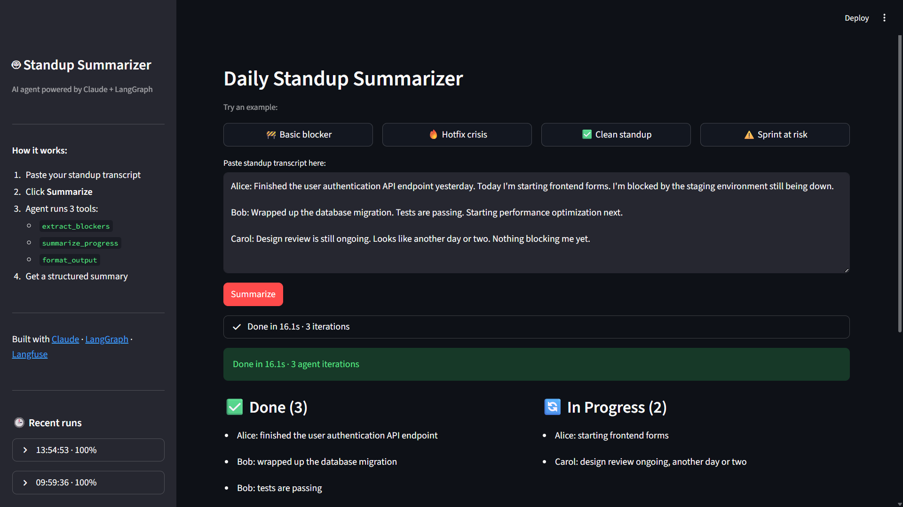

# Standup Summarizer Agent

An AI agent that transforms raw daily standup transcripts into structured, actionable summaries — built with Claude, LangGraph, and Langfuse.

## What it does

Paste a standup transcript, get back a structured summary:

| Section | What's extracted |
|---|---|
| ✅ **Done** | Completed work items |
| 🔄 **In Progress** | Current work items |
| 🚧 **Blockers** | Obstacles with owner + severity |
| 📋 **Actions** | Follow-ups with owner + deadline |

The agent understands implicit blockers ("staging is down"), compound sentences ("finished X and now working on Y"), resolved blockers, and infers action items from blockers when no one explicitly owns the fix.

## Screenshot



## Demo

```
Input:
  Alice: Finished the auth API endpoint. Starting frontend forms today.
  Blocked by staging environment still being down.

  Bob: Wrapped up the database migration. Tests passing.
  Starting performance optimization next.
```

```json
{
  "done": ["Alice: finished the user authentication API endpoint", "Bob: wrapped up the database migration"],
  "in_progress": ["Alice: starting frontend forms", "Bob: starting performance optimization"],
  "blockers": [{"description": "Staging environment is down", "owner": "Alice", "severity": "high"}],
  "actions": [{"task": "Restore staging environment", "owner": "DevOps", "deadline": "ASAP"}]
}
```

## Architecture

The agent runs a real Think → Act → Observe loop via LangGraph:

```
START → call_llm → [tool_use?] → call_tools → call_llm → ... → END
```

Three tools fire in sequence:

```
extract_blockers(transcript)    → {"blockers": [...], "risks": [...]}
summarize_progress(transcript)  → {"done": [...], "in_progress": [...], "actions": [...]}
format_output(done, in_progress, blockers, actions) → final JSON
```

Each extraction tool makes a focused single-turn LLM call: the model first reasons through the transcript speaker by speaker, checks itself against an explicit rule checklist, then emits final JSON in a fenced block (salvaged robustly by `_ensure_json`). The orchestrator (`call_llm`) decides the tool sequence; `format_output` is the terminal step that writes structured JSON into agent state.

## Eval results

Tested against 30 labeled golden examples covering edge cases: compound sentences, implicit blockers, resolved blockers, hotfix crises, sprint velocity risks, onboarding, async standups, and more.

| Category | Score |
|---|---|
| ✅ Done | **100%** |
| 📋 Actions | **100%** |
| 🚧 Blockers | **98.3%** |
| 🔄 In Progress | **91.9%** |
| **Overall** | **97.6%** (30/30 passed) |

Latest full-suite run (Claude Opus 5.5, November 2026). Claude Sonnet 4.6 scored 97.8% on the same suite in July 2026, a difference within the variation of a single run. That Sonnet score came from eval-driven iteration: up from an 88.1% baseline through scorer fixes first (re-baselined at 91.6% on the same outputs), then prompt engineering (+6.2 pp). Single-run numbers vary ±1–2 pp, because matches near the similarity threshold flip between runs, and token overlap can't see synonym pairs.

Scoring uses stemmed token overlap (Jaccard similarity) — semantic matching, not exact string comparison. Every run persists the agent's raw outputs alongside the scores, so the scorer itself can be tuned offline without re-running the API.

```bash
python -m tests.eval_golden_dataset               # full 30-example suite
python -m tests.eval_golden_dataset --limit 3     # quick smoke test
python -m tests.eval_golden_dataset --ids "04,17" # re-run specific examples
```

Partial runs (`--limit`/`--ids`) write to a separate git-ignored file so they never overwrite the full-suite baseline in `data/eval_results.json`.

### Tested and not adopted: a meaning-based score

Token overlap can't see synonyms, so I tested a model as a judge of whether an agent item means the same as the expected one. I labelled the test pairs myself and set the bar before each run: at least 90% agreement with my labels and no deliberately wrong pair accepted.

The Haiku 5.5 judge passed the first round, which would have made it official. Rescoring then gave about 80%, with Actions at 60%, and the set turned out to have no Actions pairs, so I put that rule on hold. A second set chosen by section failed at 20/29. After I wrote explicit matching rules, the result on 28 new pairs was:

| Method | Agreement with my labels (bar: 26/28) | Wrong accepts / wrong rejects |
|---|---|---|
| Haiku 5.5 judge | 18–19/28 | 1 / 8–9 |
| Opus 5.5 judge | 24/28 | 0 / 4 |
| Token overlap | 25/28 | 3 / 0 |

No method passed, including token overlap, which accepted 2 of the 5 deliberately wrong pairs. I kept token overlap as the official score because nothing better passed, not because it passed.

This is a small check with limits. 22 of the 28 pairs are matches, so always answering yes would reach 22/28. I changed four labels after the task was explained to me again, and two wrong pairs were written to test status and scope, so they aren't agent output. Some rejections may be my labels and not the judge. So this doesn't say how far 97.6% is from the true score, only that token overlap can miss a change in status or scope. The judge and its labelled pairs are in `tests/semantic_judge.py` and `data/golden_dataset/`.

## Streamlit UI

Run the web interface locally:

```bash
python -m streamlit run app.py
```

Features:
- **4 example transcripts** — click to populate and run immediately
- **Live progress** — see which tool is executing in real time
- **Run history** — last 5 runs in the sidebar with scores and Restore button
- **Export** — copy as Markdown or download as `.md` file

## Stack

| Component | Role |
|---|---|
| [Claude Opus 5.5](https://anthropic.com) | LLM for orchestration and extraction |
| [LangGraph](https://langchain-ai.github.io/langgraph/) | Agent loop, state management |
| [LangChain `@tool`](https://python.langchain.com) | Tool definition and schema |
| [Langfuse](https://langfuse.com) | Tracing, token usage, observability |
| [Streamlit](https://streamlit.io) | Web UI |

## Setup

**Prerequisites:** Python 3.12+, Anthropic API key

```bash
git clone https://github.com/kristiankocsis/agent-standup-summarizer.git
cd agent-standup-summarizer

pip install -r requirements.txt

cp .env.example .env
# Add your ANTHROPIC_API_KEY to .env
```

**Run CLI:**
```bash
python -m src.agent
```

**Run UI:**
```bash
python -m streamlit run app.py
```

**Run evals:**
```bash
python -m tests.eval_golden_dataset
```

### Langfuse (optional)

Add `LANGFUSE_PUBLIC_KEY` and `LANGFUSE_SECRET_KEY` to `.env` to enable tracing. Each run generates a trace with token counts, tool calls, and stop reasons.

## Project structure

```
src/
  agent.py        – LangGraph StateGraph, tool execution loop, run_agent()
  tools.py        – extract_blockers, summarize_progress, format_output
  config.py       – SYSTEM_PROMPT, model config, env loading
app.py            – Streamlit UI
data/
  golden_dataset/
    golden_examples.json   – 30 labeled examples
  eval_results.json        – latest eval run output
tests/
  eval_golden_dataset.py   – Jaccard-scored eval suite
  test_agent.py            – smoke tests
```

## What I learned building this

- **Prompt engineering over code** — the biggest quality jumps came from rewriting tool prompts, not the agent loop. Clear definitions ("DONE = past tense; IN PROGRESS = present tense") cut errors in half.
- **Evals first** — building the golden dataset before finishing the agent forced me to define what "correct" means. Without it, I was flying blind.
- **Semantic scoring matters** — exact string matching gave misleading 100% scores. Jaccard overlap revealed the real per-category range.
- **Concise output beats verbose output under token-overlap scoring** — semantically correct but wordy items ("Escalate to an alternative Salesforce contact to resolve the outdated API documentation issue") scored as misses; word-limit rules in the prompts ("Escalate Salesforce support ticket") recovered them.
- **Let the model think before the JSON** — rules alone got ignored in single-shot extraction (a literal counter-example in the prompt still got misclassified). Brief per-speaker reasoning plus a self-check checklist made the same rules actually fire.
- **Persist raw outputs with every eval run** — scorer improvements can then be validated offline by rescoring stored outputs, for free. When the scorer changes, re-baseline before comparing prompt changes.
- **LangGraph state is the source of truth** — capturing `format_output` JSON directly in agent state (instead of parsing LLM markdown output) made evals reliable.
- **Implicit knowledge is the hard part** — "staging is down" is an obvious blocker to a human; getting the model to consistently classify it requires explicit prompt rules, not just examples.

## Links

- [LinkedIn — Kristián Kocsis](https://linkedin.com/in/kristian-kocsis/)

## License

MIT
